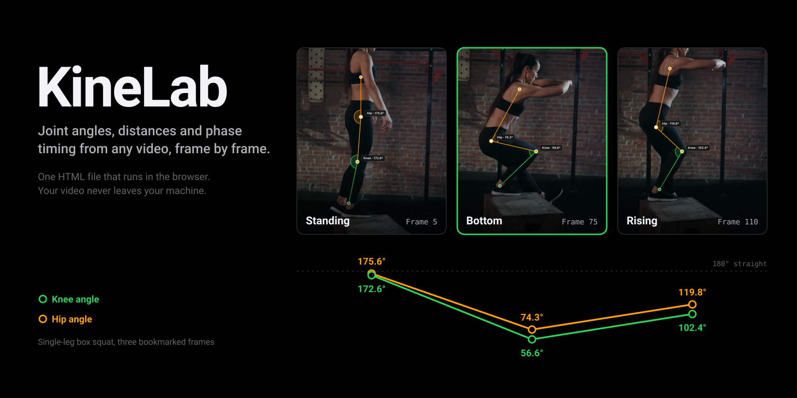
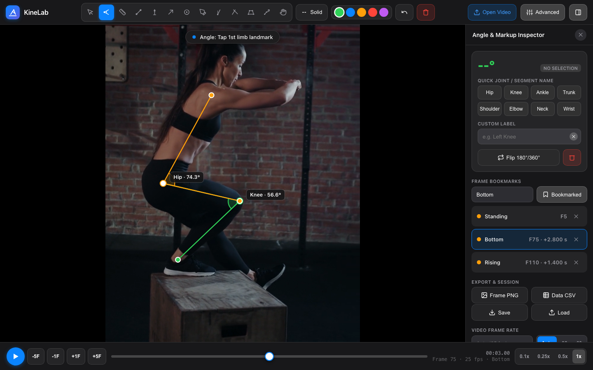
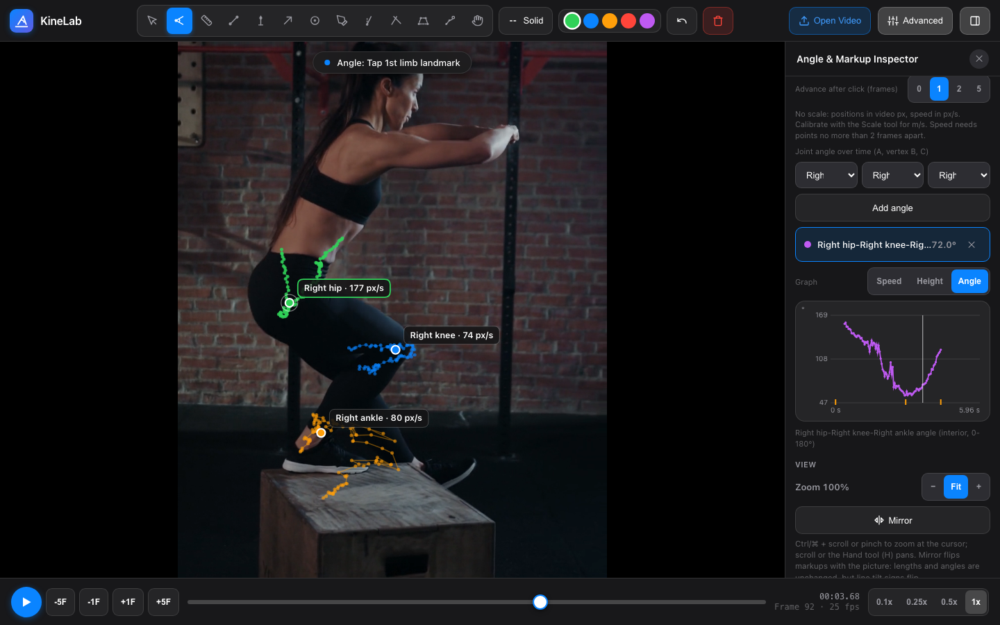
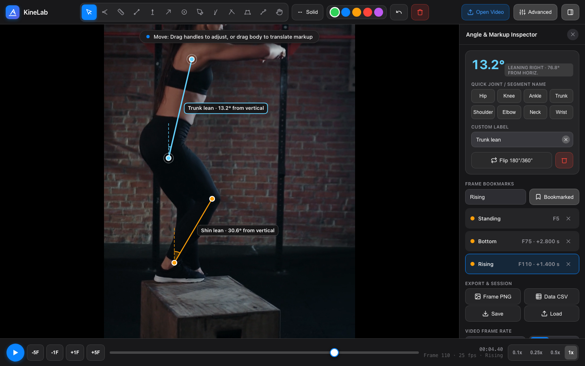

<p align="center">
  
</p>

KineLab is a video analysis tool for coaches, physios and sport science students who want numbers off a clip without paying for a Dartfish licence. Open a video, step through it a frame at a time, and draw on it: joint angles, segment tilt, calibrated distances, plumb lines. Bookmark the frames that matter (loading, take-off, landing) and each one keeps its own measurements, so you can flip between phases and compare.

The whole app is a single `index.html`. There's no install, no account and no server. Your footage is opened by the browser on your own machine and never uploaded anywhere.

## Getting started

**[Open KineLab in your browser](https://w17ant.github.io/KineLab/)**, or download `index.html` and open it in Chrome, Safari or Edge. Either way the video stays on your machine. If you'd rather try it before using your own footage, the `docs` folder has a six second side-on single-leg box squat (`box-squat-side.mp4`) and a saved session for it (`box-squat-side.kinelab.json`). Open the video, then press Load in the sidebar and pick the session file to get the angles and bookmarks in the first screenshot below.

It works with a finger or Apple Pencil on an iPad as well as with a mouse. On touch, points land a little above your fingertip so your finger never hides the joint you're aiming at, and a magnifier shows exactly where the point will go.

## A typical session

1. Open your clip with Open Video. KineLab plays it briefly at quarter speed to work out the frame rate, then parks on frame 0. If the detected rate looks wrong (some slow-motion phone exports confuse it), set it yourself under Video Frame Rate.
2. If you want distances, pick Scale and drag across something of known length in the same plane as the movement, like a box edge or a taped metre on the floor. Type the length and every line on screen recalculates straight away.
3. Step to the first phase with the arrow keys or the ±1F buttons. Each press moves exactly one frame.
4. Draw. Angle takes three taps (limb, joint, limb). Tapping an existing joint snaps to it, so a knee angle and a hip angle can share the same hip point.
5. Name the phase and press Bookmark, or hit `B`. Whatever you drew on that frame now belongs to the bookmark and disappears when you step away.
6. Repeat for each phase, then export a PNG of the frame or a CSV of everything.

<p align="center">
  
</p>

## What it measures

Joint angles are measured from three points and shown as the interior angle, with a flip button for the reflex side. Lines give you a length (once a scale is set) and a tilt from horizontal that doesn't depend on which end you drew first: 0° is level, 90° is vertical, positive means rising to the right. The plumb tool locks to true vertical or horizontal, which is handy as a reference when the camera isn't quite level. Vectors show direction of travel, markers are circles with a measurable radius, and trace is freehand for bar paths and the like.

Every reading shows up in three places that always agree: the label on the video, the inspector card, and the list of measurements on the frame.

The bookmark list shows the frame number of each phase and the time since the previous one, which is usually the number you actually want (how long was the amortisation phase, how long from lowest point to take-off).

## Getting the numbers right

The maths is only as good as the footage. A few things make a bigger difference than any tool setting.

Film side-on and square to the movement. A 2D angle from a camera at 30° off the sagittal plane can be wrong by ten degrees or more, and nothing in software can undo that. Keep the camera still too, because a scale drawn on frame 1 means nothing if the camera has zoomed by frame 40.

Put the scale reference in the same plane as the athlete. A metre stick on the near side of the track will make every distance on the far side read short.

Check the frame rate. The detector snaps to standard rates (24, 25, 30, 50, 60, 120, 240 and the NTSC variants), and the footer shows `~30 fps` with a tilde if it had to guess. Slow-motion clips that have been exported or shared from a phone are often re-timed to 30 fps even though they were filmed at 240. KineLab can only see the file, so the time between bookmarks will be in slowed-down clip time unless you type the real capture rate in yourself.

## Advanced mode

The Advanced button in the top bar adds a second set of tools for people who want more than angles and distances. Leave it off and KineLab looks and behaves exactly as described above. KineLab remembers the setting next time you open it.

**Jump height and phases.** Mark take-off and landing bookmarks and KineLab works out jump height from flight time (h = g·t²/8), with the flight time and frame count shown next to it so you can check them. Each bookmark can carry a note, and you can loop the stretch between two bookmarks at any playback speed with `L`.

**Undo, redo and autosave.** Every change goes into a proper history, so `Ctrl`/`⌘` + `Z` steps back through moves, deletes and edits, not only the last line you drew. Your work is saved in the browser as you go, keyed to the clip, so if the tab closes you're offered the analysis back next time you open the same video. `C` copies the markups on this frame 1, 2, 5 or 10 frames ahead as a new bookmark and jumps there, so you nudge the points instead of redrawing every angle on every frame.

**Point tracking.** Pick a track (hip, knee, bar, toe, or your own name) and click the joint on each frame. KineLab advances a frame after every click and draws the path. With a scale set you get speed in m/s, vertical position and acceleration, plotted against time, and you can graph a joint angle built from three tracks. Velocities use a central difference over neighbouring frames, so a gap of more than two frames breaks the line rather than inventing a number. `T` picks the tracking tool.

**Pose detection.** Detect places hip, knee, ankle, shoulder and elbow angles on the current frame using Google's MediaPipe pose model, and Track whole clip fills point tracks for a range of frames. The model (about 9 MB) downloads the first time you press it. Your video is still processed on your own machine. Treat the points as a starting draft: drag any that landed on the wrong side of the body. Pick the side nearest the camera, too. On the demo clip the right (near) leg comes out at 57.4° at the bottom of the squat against 56.6° placed by hand, while the far leg is mostly guesswork.

<p align="center">
  
</p>

The picture above came from two presses of Track this phase on the demo clip, one from Standing and one from Bottom. The graph is the knee angle worked out from the hip, knee and ankle tracks, with the three bookmarks marked along the bottom. The foot points jitter where the shoe meets the box, which is typical of pose models and why the knee curve is a little ragged.

**More measurements.** Segment gives the angle of a body segment from vertical (trunk lean, shin angle). Lines∠ measures the angle between two separate lines, like trunk against shin. Plane corrects for perspective: click the four corners of a rectangle of known size on the floor and distances measured on that plane come out right even when the camera isn't square.

<p align="center">
  
</p>

**Zoom, pan and mirror.** `Ctrl`/`⌘` + scroll or a pinch zooms at the cursor, `H` picks the hand tool for panning, `0` fits the frame again. `M` mirrors the picture so a left-side clip can be compared with a right-side one. Lengths and angles don't change when mirrored, but line tilt flips sign, since it follows what you see.

**Compare and export.** Open a second clip to play alongside the first or as a see-through overlay, nudge it a frame at a time and press Sync here to line the two up. Export video saves an MP4 of any bookmarked stretch with every markup drawn on, at full, half or quarter speed.

Everything Advanced adds goes into the session file and the CSV.

## Keyboard

| Key | Does |
| --- | --- |
| `Space` | Play or pause |
| `←` `→` | Back or forward one frame |
| `Shift` + `←` `→` | Five frames |
| `B` | Bookmark the current frame |
| `[` `]` | Previous or next bookmark |

With Advanced on you also get these:

| Key | Does |
| --- | --- |
| `Ctrl`/`⌘` + `Z`, `Ctrl`/`⌘` + `Shift` + `Z` | Undo, redo |
| `C` | Copy markups forward |
| `L` | Loop between bookmarks |
| `T` | Tracking tool |
| `H` | Hand tool |
| `+` `-` `0` | Zoom in, out, fit |
| `M` | Mirror |

## Saving and exporting

Frame PNG saves what you see on the video, cropped to the picture with no black bars, named after the clip, frame and phase (`squat_F75_Bottom.png`).

Data CSV gives one row per measurement, grouped by bookmark in time order, with frame number, time, time since the previous bookmark, value, unit and tilt. It opens cleanly in Excel and Google Sheets.

Save writes the whole analysis to a small `.kinelab.json` file. To pick up where you left off, open the same video and press Load. KineLab refuses a session saved against a video with a different shape, because every coordinate would be stretched and the angles would quietly come out wrong.

Opening a new video clears the current analysis, so save first if you want to keep it.

## Video formats

Anything your browser can play will work: MP4 (H.264 or HEVC on Apple devices), MOV from an iPhone, WebM. Older analysis software sometimes exports MPEG-4 Part 2 (DivX-era) files with an `.mp4` extension, which no browser can decode. KineLab will tell you when that happens. Converting is one line with ffmpeg:

```sh
ffmpeg -i old-export.mp4 -c:v libx264 -crf 16 -pix_fmt yuv420p fixed.mp4
```

HandBrake does the same job if you'd rather not use a terminal.

## Running it locally

There's nothing to build. Opening the file directly works, but if you're changing the code it's easier to serve the folder so the page reloads cleanly:

```sh
python3 -m http.server 8000
```

Then go to `http://localhost:8000`. The core app lives in the main `<script>` block of `index.html`, and the styling sits in the `<style>` block at the top. Each Advanced feature is a separate file in `adv/` that talks to the core through `window.KL`. After editing one, run `python3 tools/build.py` to copy them back into `index.html`, so the page still works as a single file.

## Credits

KineLab was started by [Nicholas Whittaker](https://github.com/n-whittaker/KineLab). This fork adds the calibrated scale reference, frame-accurate stepping with frame rate detection, phase bookmarks, PNG and CSV export, session files, the Advanced mode tools, and a round of fixes to how angles and distances are calculated.

The demo clip is a cut of [A Woman Exercising Over a Wooden Box](https://www.pexels.com/video/a-woman-exercising-over-a-wooden-box-7675456/) by cottonbro studio, used under the [Pexels licence](https://www.pexels.com/license/).

The original project doesn't include a licence yet, so ask the author before reusing the code elsewhere.
